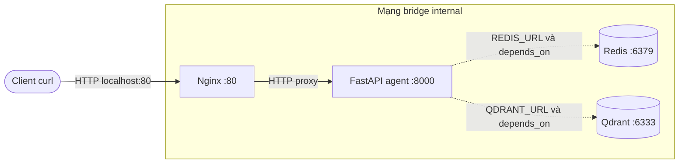

# Day 14 Lab — Mission Answers

## Part 1 — Localhost vs Production

### Exercise 1.1 — Anti-patterns trong bản develop

1. **Để thông tin nhạy cảm trong mã nguồn.** [develop/app.py dòng 17–18](01-localhost-vs-production/develop/app.py#L17-L18) chứa API key giả và chuỗi kết nối có thông tin đăng nhập minh họa. Nếu dùng giá trị thật, người có quyền đọc repo hoặc lịch sử Git có thể lấy được chúng. [production/config.py dòng 27–32](01-localhost-vs-production/production/config.py#L27-L32) đọc API key từ biến môi trường.
2. **Ghi câu hỏi, câu trả lời và API key bằng `print()`.** [develop/app.py dòng 32–38](01-localhost-vs-production/develop/app.py#L32-L38) đưa cả dữ liệu người dùng và key vào log. [production/app.py dòng 110–122](01-localhost-vs-production/production/app.py#L110-L122) ghi các trường như tên sự kiện và độ dài thay cho nội dung và key.
3. **Cố định cấu hình.** [develop/app.py dòng 21–22](01-localhost-vs-production/develop/app.py#L21-L22) đặt sẵn `DEBUG` và `MAX_TOKENS`. [production/config.py dòng 17–29](01-localhost-vs-production/production/config.py#L17-L29) cho phép thay cấu hình qua môi trường mà không phải sửa mã.
4. **Chỉ bind localhost và cố định cổng 8000.** [develop/app.py dòng 49–53](01-localhost-vs-production/develop/app.py#L49-L53) khiến agent khó dùng với container và nền tảng cấp cổng qua `PORT`. [production/app.py dòng 194–198](01-localhost-vs-production/production/app.py#L194-L198) lấy địa chỉ và cổng từ cấu hình.
5. **Luôn bật auto-reload.** [develop/app.py dòng 53](01-localhost-vs-production/develop/app.py#L53) để `reload=True`, nên thay đổi file có thể làm tiến trình phục vụ restart. [production/app.py dòng 194–198](01-localhost-vs-production/production/app.py#L194-L198) chỉ bật reload khi `DEBUG=true`, mặc định là `false`.
6. **Thiếu liveness và readiness.** [develop/app.py dòng 25–43](01-localhost-vs-production/develop/app.py#L25-L43) chỉ có route gốc và route hỏi agent. [production/app.py dòng 135–161](01-localhost-vs-production/production/app.py#L135-L161) cung cấp `/health` và `/ready` để nền tảng kiểm tra tiến trình và quyết định lúc nào nên định tuyến request.
7. **Thiếu hook dọn tài nguyên của ứng dụng.** Bản develop dùng vòng đời mặc định của Uvicorn. [production/app.py dòng 39–74](01-localhost-vs-production/production/app.py#L39-L74) thêm FastAPI lifespan để chuyển trạng thái sẵn sàng và thực hiện bước dọn dẹp khi tắt.

### Exercise 1.2 — Chạy bản develop

Chạy `python app.py` trong `01-localhost-vs-production/develop/` bằng Ubuntu WSL2, Python 3.12.3. Cài dependency theo hai file `requirements.txt` của Part 1 trong môi trường ảo tạm.

```bash
curl -sS -w '\nHTTP %{http_code}\n' -X POST 'http://localhost:8000/ask?question=Hello'
```

```text
{"answer":"Tôi là AI agent được deploy lên cloud. Câu hỏi của bạn đã được nhận."}
HTTP 200
```

`GET /health` trả HTTP `404` với body `{"detail":"Not Found"}`. Bản develop nhận `question` qua query và đã được dừng trước khi chạy bản production trên cùng cổng.

### Exercise 1.3 — So sánh develop và production

| Hạng mục | Develop | Production | Vì sao quan trọng |
| --- | --- | --- | --- |
| Cấu hình và secret | Hằng số trong mã, có giá trị minh họa cho key và thông tin đăng nhập | Đọc cấu hình từ biến môi trường. `Settings.validate()` yêu cầu `AGENT_API_KEY` khi `ENVIRONMENT=production` | Cùng một bản build chạy được ở nhiều môi trường. Có thể thay key mà không phải sửa mã hoặc build lại. |
| Địa chỉ, cổng và reload | `localhost:8000`, luôn bật reload | `HOST`, `PORT`, `DEBUG` lấy từ môi trường. Mặc định bind `0.0.0.0` và tắt reload | Container nhận được kết nối qua cổng cấp cho ứng dụng, và tiến trình tránh restart do thay đổi file khi chạy production. |
| Liveness và readiness | Thiếu cả hai route. `GET /health` trả `404` trong lần chạy thử | `/health` báo tiến trình còn sống. `/ready` dựa trên cờ vòng đời của ứng dụng và có nhánh trả `503` | Nền tảng có thể quyết định restart khi tiến trình gặp sự cố hoặc tạm ngừng chuyển traffic khi ứng dụng chưa sẵn sàng. |
| Logging | `print()` kèm câu hỏi, câu trả lời và giá trị key minh họa | Dùng `logging` và khai báo định dạng JSON. Sự kiện request/response ghi metadata, ví dụ độ dài | Trường log giúp tìm và tổng hợp sự kiện. Chỉ ghi metadata cần thiết giúp giảm nguy cơ lộ dữ liệu. |
| Shutdown | Dùng shutdown mặc định của Uvicorn | Thêm FastAPI lifespan để cập nhật cờ readiness và chạy đoạn dọn dẹp của ứng dụng | Khi nền tảng dừng tiến trình, ứng dụng có điểm để đóng kết nối và giải phóng tài nguyên. |
| Đầu vào `/ask` | Query `?question=Hello` | JSON body chứa `question`. Thiếu câu hỏi trả `422` | Client biết đặt dữ liệu ở đâu và nhận được thông báo rõ khi thiếu trường bắt buộc. |

#### Kiểm tra bản production

Khởi động bằng `HOST=127.0.0.1 PORT=8000 DEBUG=false ENVIRONMENT=development LLM_MODEL=gpt-4o-mini python app.py` từ `01-localhost-vs-production/production/`, với mock LLM.

```bash
curl -sS -w '\nHTTP %{http_code}\n' -X POST 'http://localhost:8000/ask' \
  -H 'Content-Type: application/json' -d '{"question":"Hello"}'
curl -sS -w '\nHTTP %{http_code}\n' 'http://localhost:8000/health'
curl -sS -w '\nHTTP %{http_code}\n' 'http://localhost:8000/ready'
```

```text
{"question":"Hello","answer":"Đây là câu trả lời từ AI agent (mock). Trong production, đây sẽ là response từ OpenAI/Anthropic.","model":"gpt-4o-mini"}
HTTP 200
{"status":"ok","uptime_seconds":0.4,"version":"1.0.0","environment":"development","timestamp":"2026-11-25T10:12:45.845928+00:00"}
HTTP 200
{"ready":true}
HTTP 200
```

Sau khi gửi SIGTERM, Uvicorn ghi `Application shutdown complete.` và shell nhận exit code `0`. Lúc gửi tín hiệu, các request kiểm tra đã hoàn tất.

Bản production khai báo format JSON, nhưng khi thiếu `OPENAI_API_KEY`, `config.py` gọi `logging.warning()` trước `logging.basicConfig()` của app. Lần chạy với mock không thấy các dòng log INFO của ứng dụng trong phần kiểm tra, nên kết quả chỉ xác nhận shutdown qua log Uvicorn.

## Part 2 — Docker Containerization

### Exercise 2.1 — Dockerfile cơ bản

1. **Base image.** Bản develop dùng `python:3.11`, bản phân phối Python đầy đủ. [develop/Dockerfile dòng 8](02-docker/develop/Dockerfile#L8)
2. **Working directory.** `WORKDIR /app` đặt thư mục làm việc bên trong container cho các lệnh tiếp theo. [develop/Dockerfile dòng 11](02-docker/develop/Dockerfile#L11)
3. **Thứ tự copy.** Docker copy `requirements.txt` rồi chạy `pip install` trước khi copy code. Nếu chỉ sửa code, Docker có thể dùng lại layer cài dependency. [develop/Dockerfile dòng 13–24](02-docker/develop/Dockerfile#L13-L24)
4. **CMD và ENTRYPOINT.** `CMD` cung cấp lệnh mặc định hoặc đối số mặc định cho `ENTRYPOINT`. Đối số sau tên image trong `docker run` thay thế `CMD`. `ENTRYPOINT` xác định chương trình chính và có thể được thay bằng `--entrypoint`. Image develop đặt `CMD ["python", "app.py"]`. [develop/Dockerfile dòng 29–30](02-docker/develop/Dockerfile#L29-L30)

### Exercise 2.2 — Build và chạy container develop

Build từ gốc repo bằng `docker build -f 02-docker/develop/Dockerfile -t my-agent:develop .`. Sau khi chạy image với `-p 127.0.0.1:8000:8000`, `GET /health` trả HTTP `200` với `{"status":"ok","uptime_seconds":0.2,"container":true}`.

```bash
curl -sS -w '\nHTTP %{http_code}\n' -X POST \
  'http://localhost:8000/ask?question=What%20is%20Docker%3F'
```

```text
{"answer":"Container là cách đóng gói app để chạy ở mọi nơi. Build once, run anywhere!"}
HTTP 200
```

### Exercise 2.3 — Multi-stage build và dung lượng

Chạy `docker build -f 02-docker/production/Dockerfile -t my-agent:advanced .` từ gốc repo. Stage `builder` dùng `python:3.11-slim`, cài công cụ build và cài dependency vào `/root/.local`. Stage `runtime` bắt đầu từ một base slim riêng, copy dependency đã cài cùng mã ứng dụng và chạy dưới user `appuser`. Base slim và việc bỏ các layer chứa công cụ build giúp giảm dung lượng image. [production/Dockerfile](02-docker/production/Dockerfile)

Kết quả `docker images my-agent` trên Docker Engine 28.5.1 được ghi dưới đây.

| Image | Image ID | SIZE do Docker hiển thị |
| --- | --- | ---: |
| `my-agent:develop` | `8c3bc2f0d252` | 1.67 GB |
| `my-agent:advanced` | `cba0341519f8` | 240 MB |

**Mức giảm khoảng 85,6%** theo số đã làm tròn trong cột `SIZE`, tính bằng `(1670 − 240) / 1670 × 100` sau khi đổi 1,67 GB thành 1.670 MB.

Container advanced chạy riêng trả HTTP `200` cho `POST /ask` với JSON `{"question":"What is Docker?"}`. Body trả cùng câu trả lời mock như bản develop. `docker exec <container> id -un` trả `appuser`.

### Exercise 2.4 — Docker Compose qua Nginx



> **Ý nghĩa kỹ thuật** — Nginx nhận HTTP từ máy host và chuyển tiếp đến agent theo tên service trên mạng Compose. Agent đợi Redis và Qdrant báo healthy trước khi khởi động. Hai đường đứt biểu thị cấu hình và phụ thuộc khi khởi động. Các request thử đi qua Nginx và được trả lời bằng mock LLM, nên lượt thử xác nhận luồng HTTP và trạng thái stack. [docker-compose.yml](02-docker/production/docker-compose.yml) · [nginx.conf](02-docker/production/nginx/nginx.conf) · [main.py](02-docker/production/main.py#L57-L64)

Chạy từ `02-docker/production/` sau khi tạo `.env.local` rỗng.

```bash
docker compose -p k5-day14-docker up -d --build --wait --wait-timeout 180
docker compose -p k5-day14-docker ps
curl -i http://localhost/health
curl -i -X POST http://localhost/ask \
  -H 'Content-Type: application/json' \
  -d '{"question":"Explain microservices"}'
```

`docker compose ps` cho thấy `agent`, `redis` và `qdrant` đều `running (healthy)`, còn `nginx` đang `running`.

**`GET /health` qua Nginx** (trích output)

```http
HTTP/1.1 200 OK
Server: nginx
Content-Type: application/json

{"status":"ok","uptime_seconds":4.3,"version":"2.0.0","timestamp":"2026-11-25T10:29:46.622550"}
```

**`POST /ask` qua Nginx** (trích output)

```http
HTTP/1.1 200 OK
Server: nginx
Content-Type: application/json

{"answer":"Agent đang hoạt động tốt! (mock response) Hỏi thêm câu hỏi đi nhé."}
```

Đã chạy `docker compose -p k5-day14-docker down` và kiểm tra còn 0 container của project. Compose báo thuộc tính `version` đã cũ và bỏ qua thuộc tính đó. Stack vẫn khởi động và trả kết quả như trên.

## AI log

- **CP0.** Dùng Codex để đối chiếu kế hoạch với tài liệu K5 và kiểm tra môi trường. Codex xác nhận Python trong Ubuntu là `3.12.3`, `os.name=posix`, container `hello-world` chạy được và GitHub báo repo Public. Tôi đã xác nhận CP0 trước khi chuyển sang CP1.
- **CP1.** Dùng Codex để chạy hai ví dụ, đối chiếu code và soạn câu trả lời Exercise 1.1–1.3. Các kết quả HTTP trong mục CP1 lấy từ lệnh chạy trong Ubuntu WSL2. Tôi đã xác nhận CP1 trước khi chuyển sang CP2.
- **CP2.** Sau khi tôi xác nhận CP1, dùng Codex để build hai image, đọc số đo từ `docker images`, kiểm tra container và stack Nginx, rồi ghi kết quả cùng sơ đồ Compose. Số đo và output HTTP lấy từ lượt chạy trong Ubuntu WSL2. Phần CP2 đang chờ tôi đối chiếu trước khi sang CP3.
